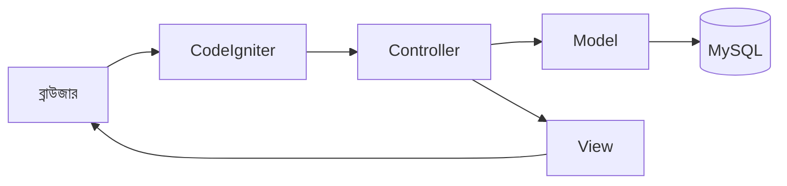

# গরু খামার হিসাব — প্রজেক্ট ডকুমেন্টেশন (ডেমো গাইড)

এই ডকুমেন্টে বোঝানো হয়েছে **এই সফটওয়্যারটা কী**, **কোড কোথায় আছে**, আর **তুমি দৈনন্দিন কাজগুলো কীভাবে করবে**।

---

## ১. সংক্ষেপে কী করে?

এটি একটি **ওয়েব অ্যাপ** (CodeIgniter 3 + MySQL)। তুমি এখানে রাখতে পারো:

| কাজ | মেনুতে নাম |
|-----|-------------|
| খামারে কত টাকা বিনিয়োগ করেছো | **বিনিয়োগ** |
| কোন ধরনের খাবার আছে (ঘাস, খড়…) | **খাদ্যের ধরন** |
| বাজার থেকে খাবার কিনলে কত কেজি, কত টাকা | **খাদ্য ক্রয়** |
| প্রতিদিন গরু কত কেজি খাবার খেল | **দৈনিক খাদ্য** |
| দুধ বিক্রি / গরু বিক্রি ইত্যাদি আয় | **আয়** |
| চিকিৎসা, শ্রমিক ইত্যাদি খরচ | **অন্যান্য খরচ** |

**ড্যাশবোর্ড** এ সব মিলিয়ে সারাংশ ও **নেট লাভ/ক্ষতি** দেখাবে।

---

## ২. টেকনিক্যালভাবে কী দিয়ে বানানো?

- **Framework:** CodeIgniter 3 (MVC প্যাটার্ন)
- **ডাটাবেজ:** MySQL (ডাটাবেজ নাম: `cow_farm`)
- **ফ্রন্ট:** HTML + Bootstrap 5 (CDN)

**MVC মানে:**

- **Model** (`application/models/`) — ডাটাবেজ থেকে ডেটা আনা/সেভ করা
- **Controller** (`application/controllers/`) — লজিক, ফর্ম চেক, মডেল কল
- **View** (`application/views/`) — ইউজার যা দেখে (টেবিল, ফর্ম)

একটা রিকোয়েস্ট এভাবে যায়:



---

## ৩. ফোল্ডার স্ট্রাকচার (মূল জায়গা)

```
cow/
├── index.php                 # সব রিকোয়েস্ট এখান দিয়ে ঢোকে
├── application/
│   ├── config/
│   │   ├── database.php      # MySQL হোস্ট, ইউজার, ডাটাবেজ নাম
│   │   ├── routes.php        # ডিফল্ট পেজ = Dashboard
│   │   └── autoload.php      # ডাটাবেজ, সেশন, হেলপার অটো লোড
│   ├── controllers/          # প্রতিটি মেনু = একটা কন্ট্রোলার ফাইল
│   ├── models/               # প্রতিটি টেবিলের মতো মডেল
│   ├── views/                # পেজের HTML
│   │   └── template/         # হেডার/ফুটার (নেভিগেশন)
│   └── helpers/
│       └── cow_helper.php    # money_fmt() — টাকা ফরম্যাট
├── database/
│   └── cow_farm.sql          # টেবিল তৈরি + প্রাথমিক খাদ্যের ধরন
└── system/                   # CodeIgniter কোর (সাধারণত এডিট করো না)
```

---

## ৪. মেনু ↔ কন্ট্রোলার ↔ মডেল ↔ টেবিল

| মেনু (URL অংশ) | কন্ট্রোলার ফাইল | মডেল | ডাটাবেজ টেবিল |
|-----------------|------------------|------|----------------|
| `dashboard` | `Dashboard.php` | একাধিক মডেল | সব টেবিল থেকে সামারি |
| `investments` | `Investments.php` | `Investment_model` | `investments` |
| `food_types` | `Food_types.php` | `Food_type_model` | `food_types` |
| `food_purchases` | `Food_purchases.php` | `Food_purchase_model` | `food_purchases` |
| `daily_feeding` | `Daily_feeding.php` | `Daily_feeding_model` | `daily_feeding` |
| `incomes` | `Incomes.php` | `Income_model` | `incomes` |
| `other_expenses` | `Other_expenses.php` | `Other_expense_model` | `other_expenses` |

**URL উদাহরণ (Laragon):**

- হোম: `http://cow.test/` বা `http://localhost/cow/`
- বিনিয়োগ তালিকা: `.../index.php/investments`
- নতুন বিনিয়োগ ফর্ম: `.../index.php/investments/add`

(যদি `index.php` URL থেকে লুকানো থাকে, তাহলে `index.php` ছাড়াই চলবে।)

---

## ৫. ডাটাবেজ টেবিলগুলোর মানে

### `food_types`

খাবারের **ক্যাটাগরি** (নাম + সাজানোর ক্রম)। `food_purchases` ও `daily_feeding` এখানের `id` ব্যবহার করে।

### `investments`

তুমি খামারে **কত টাকা ঢাললে** — তারিখ ও ঐচ্ছিক বিবরণ।

### `food_purchases`

**বাজার থেকে কেনা** — কোন ধরনের খাবার, কত **কেজি**, মোট **কত টাকা** দিয়ে কিনলে, কবে।

### `daily_feeding`

**নির্দিষ্ট দিনে গরু কত কেজি খেল** — ধরন অনুযায়ী। এটা “ব্যবহার” ট্র্যাক; টাকার হিসাব এখানে নয়, টাকা হিসাব `food_purchases` এ।

### `incomes`

**আয়** — দুধ বিক্রি, গরু বিক্রি ইত্যাদি (টাকা + তারিখ + বিবরণ)।

### `other_expenses`

খাদ্য ছাড়া **অন্যান্য খরচ** — চিকিৎসা, শ্রমিক, পরিবহন ইত্যাদি।

---

## ৬. ড্যাশবোর্ডের হিসাব (গুরুত্বপূর্ণ)

ড্যাশবোর্ডে যা দেখাবে:

| দেখানো নাম | হিসাব |
|------------|--------|
| মোট বিনিয়োগ | সব `investments` এর টাকা যোগ |
| মোট খাদ্য ক্রয় | সব `food_purchases.total_amount` যোগ |
| অন্যান্য খরচ | সব `other_expenses` যোগ |
| মোট আয় | সব `incomes` যোগ |
| **নেট লাভ / ক্ষতি** | **মোট আয় − (খাদ্য ক্রয় + অন্যান্য খরচ)** |

**বিনিয়োগ** আলাদা কার্ডে — এটা মূলত “কত টাকা খামারে ঢালা” ট্র্যাক করার জন্য; উপরের **নেট লাভ/ক্ষতি** সূত্রে বিনিয়োগ সরাসরি বাদ দেওয়া হয় না (অপারেটিং ভিউ)।

**দৈনিক খাদ্য (কেজি)** ড্যাশবোর্ডে:

- **আজকের খাদ্য** — আজকের তারিখের `daily_feeding` এন্ট্রি
- **গত ৩০ দিন** — ধরন অনুযায়ী মোট কেজি
- **সাম্প্রতিক এন্ট্রি** — শেষ কয়েকটা রেকর্ড

---

## ৭. নতুন ইউজার — কাজের ক্রম (ডেমো ওয়ার্কফ্লো)

১. **প্রথমে** `database/cow_farm.sql` ইম্পোর্ট করে ডাটাবেজ তৈরি করো।  
২. `application/config/database.php` এ MySQL ইউজার/পাসওয়ার্ড ঠিক করো।  
৩. সাইট খুলে **ড্যাশবোর্ড** দেখো।  
৪. **খাদ্যের ধরন** — প্রয়োজনে নতুন ধরন যোগ করো (SQL এ ইতিমধ্যে কিছু আছে)।  
৫. **খাদ্য ক্রয়** — যখন খাবার কিনবে, এখানে এন্ট্রি দাও।  
৬. প্রতিদিন **দৈনিক খাদ্য** — কোন খাবার কত কেজি খরচ হলো লিখো।  
৭. দুধ/গরু বিক্রি হলে **আয়** এ যোগ করো।  
৮. ডাক্তার/শ্রমিক খরচ হলে **অন্যান্য খরচ** এ দাও।  
৯. যে টাকা খামারে বিনিয়োগ হিসেবে ঢালছো সেটা **বিনিয়োগ** এ রাখো।  

এভাবে ডেটা পূর্ণ হলে ড্যাশবোর্ডের সংখ্যাগুলো অর্থবহ হয়ে উঠবে।

---

## ৮. কোডে একটা পেজ কীভাবে বানানো (উদাহরণ)

যেমন **বিনিয়োগ তালিকা**:

1. ব্রাউজার `Investments` কন্ট্রোলারের `index` মেথড কল করে।
2. `Investment_model::get_all()` ডাটাবেজ থেকে সব রো আনে।
3. কন্ট্রোলার `views/investments/index.php` লোড করে।
4. ভিউতে টেবিল HTML এ দেখায়।

নতুন এন্ট্রি:

- `investments/add` → GET এ ফর্ম দেখায়, POST এ ভ্যালিডেশন → `Investment_model::create()` → রিডাইরেক্ট তালিকায়।

---

## ৯. ছোট টিপস

- **খাদ্য ক্রয়** = টাকায় কত খরচ। **দৈনিক খাদ্য** = কেজিতে কত খেয়েছে। দুটোই দরকারি।
- একই দিনে এক ধরনের খাবারের জন্য একাধিক সারি থাকতে পারে (সকাল/বিকাল আলাদা লিখতে চাইলে)।
- `food_types` মুছতে গেলে যদি সেই ধরন ব্যবহারে থাকে, ডাটাবেজ বাধা দিতে পারে (foreign key)।

---

## ১০. সমস্যা হলে

- ডাটাবেজ কানেকশন চেক করো (`database.php`)।
- `cow_farm` ডাটাবেজ ও টেবিল ইম্পোর্ট হয়েছে কিনা দেখো।
- PHP ভার্সন 8.x এ CodeIgniter 3 এর কিছু ডিপ্রিকেশন প্যাচ করা আছে `system/` ফোল্ডারে।

---

*এই ফাইলটি প্রজেক্ট রুটের `docs/` ফোল্ডারে আছে — ভবিষ্যতে নতুন ফিচার যোগ হলে একই ডক আপডেট করা যায়।*
